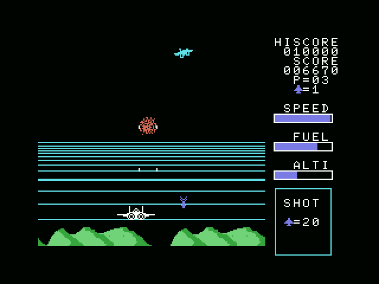
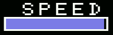
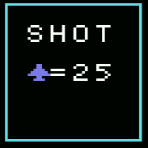
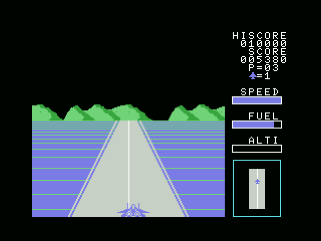
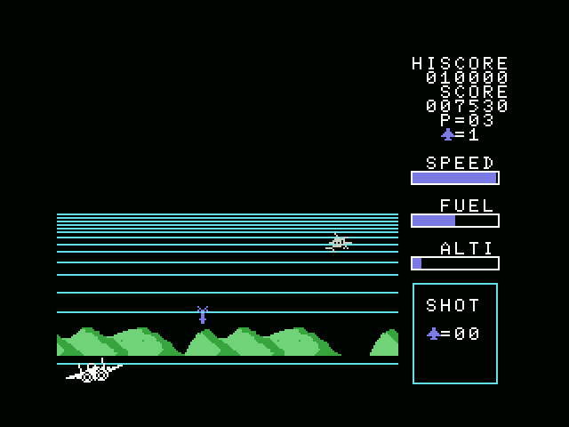
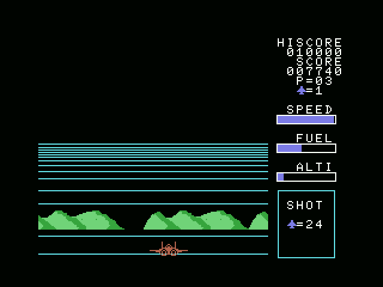
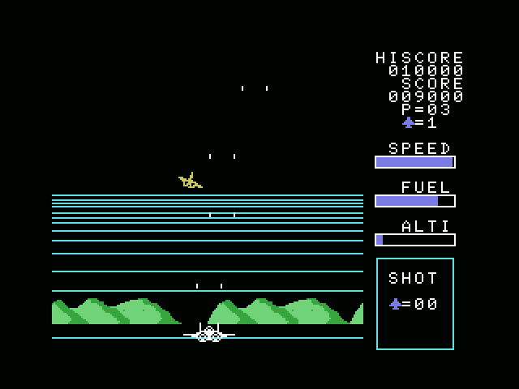

# MSX イーグルファイター © CASIO / 1985


## 基本

EAGLE FIGHTERは1985年にCASIOがMSX用ソフトとして販売した一風変わった特徴を持つフライトシミュレーション風STGゲームです。

フライトシミュレーション風なので、下入力で上昇・上入力で下降です。

空中戦は普通のSTGと同じシステムでありながら、上下方向が逆なので癖の強い操作となっていたり、  
離陸・着地・空中空輸ミッションがあるのが特徴です。

独特の進行とシステムについて理解することでゲームを遊びやすくなると思いますので解説していきます。

解説を読んでシステムを理解すれば結構遊べるゲームだと思いますが、  
やっぱり癖が強くて心が折れそうな人向けにパッチも用意してあります。

- 普通のSTGのように遊びたい人→ [空中：上下移動反転パッチ](EagleFighter_ud_mod.ips)
- さらに離陸と着地も簡単にしたい人→ [空中＋離着陸：上下移動反転変更パッチ](EagleFighter_easy_mod.ips)
- パッチの解説は[解析＆パッチ： 操作方法の変更](#%E8%A7%A3%E6%9E%90%E3%83%91%E3%83%83%E3%83%81-%E6%93%8D%E4%BD%9C%E6%96%B9%E6%B3%95%E3%81%AE%E5%A4%89%E6%9B%B4)

※ パッチを当てた場合、解説とは上昇下降の入力が逆になりますのでご注意ください。

### ゲームの流れ

離陸 → 空中戦 → 空中給油（PHASE 03以降）→ 着陸 で、PHASE（ステージ）クリア。
FUEL（燃料）が無くなったり、敵や敵弾に当たるとミス。  
離陸や着地に失敗してもミス。

ミスをすると残機が1つ減り、ステージの最初からやり直し。  
残機が0になるとゲームオーバー。


## 画面説明

### P=01：PHASE（ステージ）


いわゆるステージ。P=01はステージ1。  
PHASE 03 以降はPHASE中間地点で空中給油ミッションがある。  
PHASE 01 は敵が弾を撃たないので練習に良い。
### ✈=0：残機


飛行機アイコンのついた数字は残機数。  
エクステンドは初回 20,000点。  
以降 20,000点ごと（40,000点、60,000点、80,000点…）で最大9機まで増える。
### SPEED：速度



離陸時は最大まで上げる事が大切。  
飛行中は一定。  
着陸後は0まで下げて停止する事が大切。
### FUEL：燃料


時間経過で減っていくタイマーのような物。  
着地成功、または空中給油成功で回復する。
燃料が空になると高度が下がっていき、地面に衝突すると爆発します。
### ALTI：高度


離陸時に上昇する。  
空中ではただのY座標。  
着陸時は高度を0まで下げることが大切。
### SHOT：撃破ノルマ残数



敵を撃破すると減っていき、ノルマが0になってから敵を倒すと次のミッションへ進む。

-  PHASE 01～02は1回目のノルマ達成で着陸ミッションへ。
- PHASE 03以降は1回目のノルマ達成で虹色の敵～空中給油。  
    2回目のノルマ達成で着陸ミッションへ。

## 1. TAKE OFF (離陸)



PHASE（ステージ）は滑走路から始まる。  
速度を上げて離陸しよう。  
TAKE OFF に成功すると空中戦へ。

- 方向：左右で横移動
- 方向：上を押し続けるとSPEEDが上がる
- SPEEDが最大になったら、方向：下+トリガー1で離陸

### 👉ポイント

- **SPEED**が足りないと上手く離陸できずに爆発四散する。 
- 左右に揺れるのでセンターを維持するように左右調整しよう。  
    **中央をキープする事が大切。**
- 中央からズレすぎると傾いて失速し、爆発四散する。
- 滑走路が終わるまでに離陸できないと爆発四散する。
- 燃料が無くなると高度が下がっていき、地面に接触すると爆発四散する。

## 2. AIR FIGHT （空中戦）


離陸すると空中戦が始まる。  
敵を撃破するごとにSHOT（撃破ノルマ）が減っていき、  
ノルマを達成すると次のステップへ進める。

- 左右方向：横移動
- 上方向：下降（画面**下**へ移動）
- 下方向：上昇（画面**上**へ移動）
- トリガー1：攻撃

### 👉ポイント

- **虹色に点滅する「スパイ機」** を倒すと空中給油機が出現する。（PHASE 3 から登場）
- 燃料が無くなると高度が下がっていき、地面に接触すると爆発四散する。

## 3. DESTROY SPY PLANE （偵察機を撃破せよ）



PHASE3以降は最初のノルマ達成時に虹色に点滅するスパイ機が出現。  
これを撃破すると空中給油機が出現する。
### 👉ポイント

- - この虹色のスパイ機を撃ち逃すと、撃破ノルマやり直しとなる。

## 4. DOCKING（給油機とのドッキング）



PHASE 3 以降で登場する空中給油機とのドッキングミッション。  
給油機が画面に現れて燃料ホースを垂らしてくるので、ホースの先端に自機をドッキングさせる。

- 方向：左右で移動    
- 方向：上で下降    
- 方向：下で上昇    

ドッキングに成功するとFUELが回復する。

### 👉ポイント

- ホースの先ではなく給油機に特攻すると爆発四散する。    
- 燃料が無くなると高度が下がっていき、地面に接触すると爆発四散する。

## 5. LANDING (着陸)



着陸～停止に成功すると補給が始まる。  
補給が終わりFUELが回復すると、次のステージへ進む。

- 左右方向：横移動    
- 上方向：高度（ALTI）を下げる    

滑走路に到達したら高度（ALTI）を0まで下げると自機が着地し、  
地上を滑走し始める。（自機グラフィックが変化する）

- 滑走状態になったら、下方向を押し続けてSPEEDを下げる    
- SPEEDが０になると停止し、補給開始。    

無事補給が終わればPHASEクリアとなる。

### 👉ポイント

- 滑走路が画面下まで到達してから着地するのがコツ。  
    その前に着地しようとすると爆発四散する。    
- 左右に揺れるのでセンターを維持するように左右調整しよう。    
- 自機のグラフィックが着地滑走状態に変わっても下降入力し続けると、  
    あっという間に爆発四散する。  
    **着地したら素早く方向キーを離す**ことが大切。  
    それから落ち着いて下方向を入力して減速をすれば十分に間に合う。    
- 滑走路が終わるまでにSPEEDを0にして停止できないと爆発四散する。    
- 燃料が無くなると爆発四散する。

---

## 裏技

存在しない。
解析でも見つからず。

---

## 解析＆パッチ： 操作方法の変更

## パッチ一覧

- 普通のSTGのように遊びたい人→ [空中：上下移動反転パッチ](EagleFighter_ud_mod.ips)
- さらに離陸と着地も簡単にしたい人→ [空中＋離着陸：上下移動反転変更パッチ](EagleFighter_easy_mod.ips)


※ROMファイルオフセット ＝ `メモリアドレス - 4000H`。

### 必須パッチ（空中での上昇下降入力変更）

|     アドレス    |  ROMオフセット  | 命令・役割         |    元の値     |    変更後の値     | 変更の理由・構造上の意味                               |
| :-------------: | :-------------: | :----------------- | :-----------: | :---------------: | :----------------------------------------------------- |
|     `8775H`     |     `4775H`     | `cp 01H` の引数    |     `01H`     |     **`05H`**     | **【空中判定】** 下入力(`05`)で下降ルーチンへ          |
|     `8779H`     |     `4779H`     | `cp 02H` の引数    |     `02H`     |     **`04H`**     | **【空中判定】** 右下入力(`04`)で下降+右へ             |
|     `8781H`     |     `4781H`     | `cp 04H` の引数    |     `04H`     |     **`02H`**     | **【空中判定】** 右上入力(`02`)で上昇+右へ             |
|     `8785H`     |     `4785H`     | `cp 05H` の引数    |     `05H`     |     **`01H`**     | **【空中判定】** 上入力(`01`)で上昇ルーチンへ          |
|     `8789H`     |     `4789H`     | `cp 06H` の引数    |     `06H`     |     **`08H`**     | **【空中判定】** 左上入力(`08`)で上昇+左へ             |
|     `8791H`     |     `4791H`     | `cp 08H` の引数    |     `08H`     |     **`06H`**     | **【空中判定】** 左下入力(`06`)で下降+左へ             |
|     `875AH`     |     `475AH`     | `ld a, 01H` の即値 |     `01H`     |     **`05H`**     | **【墜落代入】** 無入力/上時、中央下降(`05`)に置き換え |
|     `8762H`     |     `4762H`     | `ld a, 02H` の即値 |     `02H`     |     **`04H`**     | **【墜落代入】** 右系入力時、右下降(`04`)に置き換え    |
|     `876AH`     |     `476AH`     | `ld a, 01H` の即値 |     `01H`     |     **`05H`**     | **【墜落代入】** 下入力時、中央下降(`05`)に置き換え    |
|     `876EH`     |     `476EH`     | `ld a, 08H` の即値 |     `08H`     |     **`06H`**     | **【墜落代入】** 左系入力時、左下降(`06`)に置き換え    |
|     `8BAFH`     |     `4BAFH`     | `cp 05H` の引数    |     `05H`     |     **`01H`**     | **【給油判定】** 上入力(`01`)でドッキング成立          |

### オプションパッチ（離着陸時の上昇下降入力変更／方向押しっぱなしでの離陸＆着地を許可する）

|     アドレス     |  ROMオフセット   | 命令・役割      |        元の値          |        変更後の値          | 変更の理由・構造上の意味                                                 |
| :--------------: | :--------------: | :-------------- | :--------------------: | :------------------------: | :----------------------------------------------------------------------- |
| `85C6H`〜`85CCH` | `45C6H`〜`45CCH` | 7バイト処理     | `AF 32 40 E0 32 44 E0` | **`00 00 00 00 00 00 00`** | **【離陸無効化】** 加速中のトリガークリアをNOP化                         |
|     `8683H`      |     `4683H`      | `cp 05H` の引数 |         `05H`          |         **`01H`**          | **【離陸判定】** 上＋トリガーでテイクオフ                                |
| `8858H`〜`8859H` | `4858H`〜`4859H` | `jr z, 887EH`   |        `28 24`         |        **`C8 00`**         | **【高度0での下降入力による激突防止】** `ret z / nop` に変更し即死無効化 |

---

### 解析： 空中での上下移動を逆にしたい

#### 【必須①】空中操作の上下反転（判定値の変更）
空中飛行中（空中戦・着陸アプローチ）の操作判定ルーチン。

```assembly
; === アドレス 8774H: 空中の方向入力判定 ===
LABEL_00_8774H:
    cp 01H               ; [1: 上]   -> 元は 87D3H (下降ルーチン) へ
    jr z, LABEL_00_87D3H
    cp 02H               ; [2: 右上] -> 元は 87C4H (下降＋右) へ
    jr z, LABEL_00_87C4H
    cp 03H               ; [3: 右]   -> 87B8H (右) へ
    jr z, LABEL_00_87B8H
    cp 04H               ; [4: 右下] -> 元は 87A9H (上昇＋右) へ
    jr z, LABEL_00_87A9H
    cp 05H               ; [5: 下]   -> 元は 879DH (上昇ルーチン) へ
    jr z, LABEL_00_879DH
    cp 06H               ; [6: 左下] -> 元は 87FAH (上昇＋左) へ
    jr z, LABEL_00_87FAH
    cp 07H               ; [7: 左]   -> 87EEH (左) へ
    jr z, LABEL_00_87EEH
    cp 08H               ; [8: 左上] -> 元は 87DFH (下降＋左) へ
    jr z, LABEL_00_87DFH
```
* **解説**:
  レバー入力値（1〜8）に対して、どの移動ルーチンへ分岐させるかを `cp` 命令で判定。
  ここでは `cp` の比較対象値を入れ替えることで、**「どの入力が来たときに下降／上昇ルーチンへ飛ばすか」という条件判定の基準**を変更。

#### 【必須②】燃料切れ（FUEL=0）墜落処理（置き換え値の変更）
通常の空中操作の直前にある、燃料切れ時の特殊処理。

```assembly
; === アドレス 8752H: 燃料切れ時の強制滑空（急降下）処理 ===
    ld a, (WORK_E198H)   ; プレイヤーの入力値 (0〜8) を取得
    cp 02H               ; A < 2 (無入力:0 または 上:1)
    jr nc, LABEL_00_875DH
    ld a, 01H            ; ★ Aを「旧仕様の中央下降(01H)」に強制代入
    jr LABEL_00_8774H    ; 通常の判定ルーチン(8774H)へ合流

LABEL_00_875DH:
    cp 05H               ; 2 <= A < 5 (右系: 2, 3, 4)
    jr nc, LABEL_00_8765H
    ld a, 02H            ; ★ Aを「旧仕様の右下降(02H)」に強制代入
    jr LABEL_00_8774H

LABEL_00_8765H:
    cp 06H               ; A == 5 (下: 5)
    jr nc, LABEL_00_876DH
    ld a, 01H            ; ★ Aを「旧仕様の中央下降(01H)」に強制代入
    jr LABEL_00_8774H

LABEL_00_876DH:
    ld a, 08H            ; ★ A >= 6 (左系: 6, 7, 8) を「旧仕様の左下降(08H)」に強制代入
    jr LABEL_00_8774H
```
* **解説（空中操作との違い）**:
  空中操作のように「ルーチンの分岐先を決める判定」をしているのではなく、**「プレイヤーの入力を無視して、Aレジスタに強制的に下降用の方向値を上書き（置き換え）した上で、直後の通常判定（`8774H`）へ流し込む」**という処理。
  * **旧仕様**: 下降を表す方向値が上系（`01H`, `02H`, `08H`）だったため、それらの値で置き換えている。
  * **パッチの意図**: 【必須①】で通常判定を変更した結果、下降ルーチンへ行くための値が下系（`05H`, `04H`, `06H`）に変わりました。そのため、この墜落処理で**置き換える代入値（`ld a, nn` の即値）も下系へと連動して変更**する必要がある。
  * ※レバー入力の分類条件（`cp 02H`, `cp 05H`, `cp 06H`）は「中央・右系・左系」の振り分けを行っているだけなので、変更する必要はない。

#### 【必須③】空中給油のドッキング操作（判定値の変更）
給油機（画面上部）に接触した際のドッキング判定ルーチン。

```assembly
; === アドレス 8B9FH: ドッキング成立判定 ===
LABEL_00_8B9FH:
    cp 30H               ; Y座標が給油ノズル位置か？
    ret nc
    ld a, (ix+1)         ; X座標が合っているか？
    cp 63H
    ret c
    cp 66H
    ret nc
    ld a, (WORK_E198H)   ; レバー入力値を取得
    cp 05H               ; ★ 元は「下入力(05H)」が成立条件
    ret nz
    ld a, 05H
    ld (WORK_E1C7H), a   ; ドッキング成立
```
* **解説**:
  旧仕様では給油機に向かって前進（上昇）する操作が「下」だったため、条件が `cp 05H`（下）になっていた。
  【必須①】で前進操作が「上」に変わったため、判定値を `cp 01H`（上）に同期させる必要がある。

---

### 解析： 離着陸時の上下移動を逆にしたい

#### 離陸操作の「上＋トリガー」化

滑走路の地上走行ルーチン内にあるテイクオフ判定。

```assembly
; === アドレス 85C6H: 上入力（加速時）のトリガークリア ===
LABEL_00_85C6H:
    xor a
    ld (WORK_E040H), a   ; ★ 上入力中はトリガー1フラグを消去
    ld (WORK_E044H), a   ; ★ 上入力中はスペースキーフラグを消去
    ld a, (WORK_E19EH)   ; 速度取得 (加速処理へ)

; === アドレス 8682H: テイクオフ判定 ===
LABEL_00_8682H:
    cp 05H               ; ★ 元は「下入力(05H)」でテイクオフ判定
    jr nz, LABEL_00_86C6H
    ... (離陸処理へ)
```
* **解説**:
  元々は「上＝加速」「下＋トリガー＝操縦桿を引いて離陸」という分担だったため、加速中にトリガーが誤爆しないよう `85C6H` でトリガー入力を強制消去していた。
  「上＋トリガー」で離陸させるためには、**この消去処理（計7バイト）を `NOP` で無効化**した上で、テイクオフ判定の比較値を `05H`（下）から `01H`（上）へ変更する。

#### 着陸時の高度0激突（下降押しっぱなしでの衝突）

下降ルーチン（高度減少処理）の先頭にある激突判定。

```assembly
; === アドレス 8853H: 下降ルーチン ===
LABEL_00_8853H:
    ld a, (WORK_E1A5H)    ; 高度(ALTI)
    cp 00H                ; 高度 == 0 か？
    jr z, LABEL_00_887EH  ; ★ 高度0の瞬間に下降入力が入っていると即死！
    ...
LABEL_00_887EH:
    ld a, 01H
    ld (WORK_E19BH), a    ; ミス！
    ret
```
* **解説**:
  高度が0になった後も下降（下）を入力し続けていると、この `jr z, LABEL_00_887EH` で地面激突死していた。
  このジャンプ命令を **`ret z`（高度0なら何もしないでリターン）** に書き換えることで、高度0のまま安全に接地ルーチンへ受け渡され、押しっぱなしにしていた下入力がそのまま地上滑走のブレーキ減速ルーチンへとシームレスに引き継がれる。


