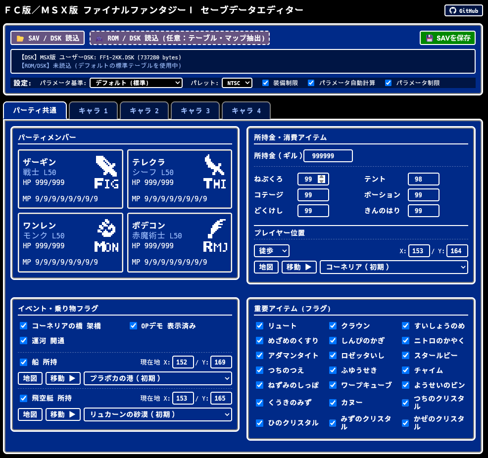
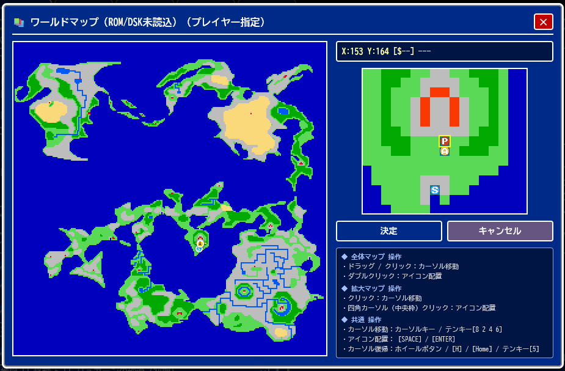
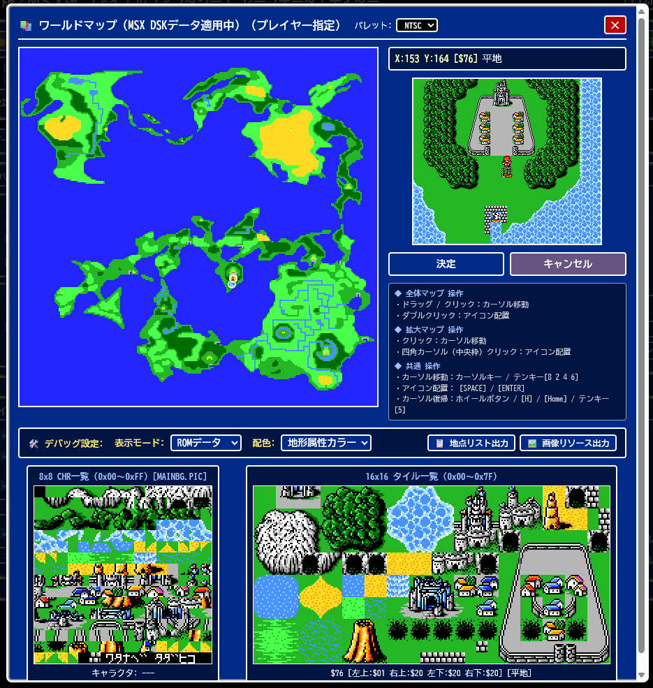

# FC版・MSX版対応 ファイナルファンタジーⅠ セーブデータエディタ

オンラインから実行：  
<https://uniskie.github.io/MSX_GAME_TOOL/FF1SaveEditor/ff1_editor.html>

- **MSX版** : ユーザーディスクイメージ（DSKファイル）をエディタウィンドウにドロップしてください。
- **FC版**  : SAVファイルをエディタウィンドウにドロップしてください。

  ※ 注） RetroFreakのSAVファイルなどの、特殊なヘッダがついたセーブデータの場合は、ヘッダを除去したものをドロップしてください。

編集が終わったら保存ボタンをおすとダウンロードフォルダに編集後のセーブデータが保存されます。



## ファイル構成

- [ff1_editor.html](ff1_editor.html)
- [ff1_editor_world_map.js](ff1_editor_world_map.js)
- [ff1_editor_world_sprites.png](ff1_editor_world_sprites.png)

※ ff1_editor_world_map.js はローカル環境用の画像データです。ローカル環境ではjsコードから画像のピクセル情報を参照できない為、base64エンコードで用意した画像ファイルです。  
[ff1_editor_world_map.png](ff1_editor_world_map.png) を [bmp16_to_js.py](bmp16_to_js.py) で変換しています。

オンライン環境（サーバ経由）であれば、
[ff1_editor_world_map.js](ff1_editor_world_map.js) の代わりに [ff1_editor_world_map.png](ff1_editor_world_map.png) があれば問題ありません。

- ジョブ画像
  [ff1_editor_class_icon.png](ff1_editor_class_icon.png)相当の画像を自分で用意して、`ff1_editor_class_chr.png`として配置しておくと、ジョブ画像として使用されます。

## 簡易ガイド

### 名前入力

ゲーム中のフォントで使用できる文字を受け付けます。

カタカナも使えますが、カタカナの小さい「ゥ」はゲーム中にフォントが存在しないので「ウ」に強制変更されます。

アルファベットは`L`、`E`、`H`、`P`のみ受け付けます。

### [地図]



おまけ的な機能です。

初期状態では簡易的なマップ表示ですが、ROMを読み込ませると正確なマップが表示できます。

簡易表示の場合

- [ff1_editor_world_map.js](ff1_editor_world_map.js) または、 [ff1_editor_world_map.png](ff1_editor_world_map.png)
- [ff1_editor_world_sprites.png](ff1_editor_world_sprites.png)

を使用して表示します。

### パラメータ自動計算

レベル変更時、成長テーブルに従ってパラメータを自動計算します。

テーブルはLV50までなので、上限制限を無効にしても自動計算が有効な時はLV上限が50までとなります。

### ファミコン版ROMイメージ/MSX2版ディスクイメージ をドロップすると

ちょっとした機能が強化されます。

ゲーム中の雰囲気を味わいたい人向けの機能です。

- グラフィックがROM/DSKから読み込んだゲーム中グラフィックに変わります。
- 成長テーブルやアイテムテーブルがROM/DSKから読み込んだものに変わります。
- [地図]ボタンで表示されるワールドマップROM/DSKから読み込んだものに変わり、
  拡大ビューがブロック塗りつぶしタイルではなくゲーム中のような表示になります。

  
  

- ファミコン版ROMはUS版/JP版両対応（自動判定）です。

## エディタ用画像 → js変換

- 16色BMP --> base64エンコード文字列
  [bmp16_to_js.py](bmp16_to_js.py) ...  
  [ff1_editor_world_map.bmp](ff1_editor_world_map.bmp) を jsソースに変換
- 透明/不透明2値 → 1bppパターンデータ
  [class_icon_to_js.py](class_icon_to_js.py)  
  [ff1_editor_class_icon.png](ff1_editor_class_icon.png) を jsソースに変換

## 参考資料

### 参考：FC版 ファイナルファンタジー 解析資料

- Data Crystal - Final Fantasy  
  <https://datacrystal.tcrf.net/wiki/Final_Fantasy>
- FFHacksterEX  
  <https://ffhacksterex.digitaldreamers.org/>  
  <https://github.com/ffhacksterex/FFHacksterEx/tree/v0.9.8.2-beta>
- HakkinFF1  
  <https://hakkinff1.digitaldreamers.org/index.html>

### 参考：MSX版ファイナルファンタジー 解析資料

- Final Fantasy MSX Performance Patch  
  <https://github.com/abekermsx/Final-Fantasy-MSX-Performance-Patch>
- Final Fantasy MSX2 Gfx De-Compressor  
  <https://github.com/romh-acking/final-fantasy-msx2-de-compressor>
- Final Fantasy MSX2 SayDos tool  
  <https://github.com/romh-acking/final-fantasy-msx2-say-dos-tool/tree/master>

## 更新履歴

### ff1_editor.html

- 2026/11/14  
  MSX版セーブデータ保存時、装備画面での再計算時に参照される素パラメータ（`+0x28`: 力/2、`+0x29`: 素の命中率、`+0x2A`: 素の回避率）を同期して書き込むように修正。
- パラメータ自動計算時のジョブ別命中率計算（初期値およびレベルアップごとの成長値）を実機仕様に準拠した式へ修正。

---

# MSX版推奨パッチの紹介

## Final Fantasy MSX Performance Patch

<https://github.com/abekermsx/Final-Fantasy-MSX-Performance-Patch>

MSX2版がフレームレート制限の解除と速度最適化により、移動が快適になるパッチです。  

MSX2/2+でも大きな効果がありますが、MSX turboRではさらに快適になります。
場所によっては速すぎて困るケースも？

メッセージウィンドウの表示速度まで高速になるので、会話ウィンドウ開閉時の音に違和感は出ますが、
基本的に全体が快適になります。

VDPの処理がボトルネックなので、もともと処理落ちするところはやっぱり処理落ちします。（無改造よりマシですが）

---

## 自作パッチ

| パッチファイル（ipsファイル）                              | 内容                                                   |
| :--------------------------------------------------------- | :----------------------------------------------------- |
| [FF1-1-BGM_Fix.ips](FF1-1-BGM_Fix.ips)                     | BGM割り当て修正                                        |
| [FF1-1-BugFix.ips](FF1-1-BugFix.ips)                       | 戦闘&マップバグ修正                                    |
| [FF1-1-BugFix_at.ips](FF1-1-BugFix_at.ips)                 | 戦闘&マップバグ修正 + 自動ターゲット                   |
| [FF1-1-BGM_and_BugFix.ips](FF1-1-BGM_and_BugFix.ips)       | BGM割り当て修正 + 戦闘&マップバグ修正                  |
| [FF1-1-BGM_and_BugFix_at.ips](FF1-1-BGM_and_BugFix_at.ips) | BGM割り当て修正 + 戦闘&マップバグ修正 + 自動ターゲット |

### openMSX用 バトルOSDスクリプト

[ff1_battle_overlay.tcl](ff1_battle_overlay.tcl)

#### 使用方法

ユーザーフォルダ（Windowsであればマイドキュメント/openMSX）の
`share/scripts` に `ff1_battle_overlay.tcl` 配置 して、openMSXを起動。

`F10`などで出るtcl コンソールから制御します。

- 表示 `ff1_battle_overlay on`
- 消去 `ff1_battle_overlay off`
- 表示切替 `ff1_battle_overlay toggle`

自分でスクリプトを弄って、実行中に再読み込みさせたい場合は
```
source $::env(OPENMSX_USER_DATA)/scripts/ff1_battle_overlay.tcl
```
のようにすれば、スクリプトが再読み込み＆再実行されます。

※ 再読み込みをしてもグローバルな変数などは残ったままなので注意

### MSX2版 BGM割り当て修正パッチについて

[FF1-1-BGM_Fix.ips](FF1-1-BGM_Fix.ips)

MSX2版ファイナルファンタジーは
ダンジョンのBGMがファミコン版と異なる曲が鳴る場所がいくつかあります。

ファミコン版を遊んだ人は、それなりに違和感を感じると思うので、
ファミコン版準拠のBGM割り当てに修正するパッチを作りました。

| マップ         | MSX2版      | ファミコン版 |
| :------------- | :---------- | :----------- |
| カオスの神殿   | KAITEI.BGM  | KAOSS.BGM    |
| 沼の洞窟       | MATOOYA.BGM | RANCHON.BGM  |
| ミラージュの塔 | GURUGU.BGM  | RANCHON.BGM  |
| 海底神殿       | KAITEI.BGM  | KAOSS.BGM    |
| ラスダン       | KAOSS.BGM   | KAITEI.BGM   |
| 巨人の洞窟     | KAOSS.BGM   | GURUGU.BGM   |

解析の詳細を知りたい物好きは[doc/ff1_msx_bgm_memo.md](doc/ff1_msx_bgm_memo.md) をどうぞ。

---

### MSX2版 バグ修正パッチについて

[FF1_MSX_BugFix.py](FF1_MSX_BugFix.py)

※ 実行はpython3.14.6推奨。

```text
py FF1_MSX_BugFix.py 元DSKパス パッチ後DSKパス
```

**[ファミコン版 FF1J_Bugfixes](doc/FF1J_FC_Bugfixes_jp.md)**相当のパッチを作成。

- ファミコン版 FF1J_Bugfixes.ips -> <https://www.romhacking.net/hacks/5597/>  
  (アクセスできない時はFireFoxの組み込みVPNを使うといけたりします。)

MSX2版では既に製品版で対応済みのバグがいくつかあるのと、動作が変更になっている部分もあるので、出来るだけ ファミコン版+FF1J_Bugfixes に近い動作になるようなパッチとしてみました。

### MSX版とFC版の主な仕様・バグ状況の違い

移植元であるFC版の既知バグのうち、MSX版で既に解消されている項目および仕様差の比較です。

| 項目                   | FC版の実態                                                        | MSX版の実態                                                           | 本パッチでの対応           |
| :--------------------- | :---------------------------------------------------------------- | :-------------------------------------------------------------------- | :------------------------- |
| プロテス（敵使用時）   | 敵プロテス時にROMの初期値を参照し、効果が正しく機能しない         | RAMの敵バッファから正しく参照しており、防御力が正常に上昇             | 修正不要（元から解消済）   |
| 追加効果（ミス時）     | 物理攻撃が0ヒット（ミス）でも状態異常などの追加効果が発生する     | ヒット数0判定が実装されており、0ヒット時は追加効果不発                | 修正不要（元から解消済）   |
| カヌーのアイテム表示   | カヌー入手後も重要アイテム一覧にカヌーが表示されない              | フラグ管理が一元化されており、アイテム一覧に正常表示                  | 修正不要（元から解消済）   |
| 宿・テントのMPセーブ   | セーブ処理の後にMP回復が行われるため、回復分がセーブされない      | セーブ前にMP全回復処理が完了しており、回復状態でセーブされる          | 修正不要（元から解消済）   |
| NPC初期配置ミス        | 城の女性NPCが室内フラグ誤りで非表示、滝の洞窟のコウモリが壁内埋没 | 城の女性NPCは常時正常表示、滝の洞窟にはコウモリ未配置（ロボットのみ） | 修正不要（元から解消済）   |
| NPCの台詞変化条件      | オンラク老人が土オーブ参照、クレセント湖賢者の全点灯判定に不備    | オンラク老人は水オーブ参照、賢者は4オーブ全点灯判定が実装済           | 修正不要（元から解消済）   |
| 4大祭壇の調査判定      | 判定処理の誤りにより、火・風の祭壇を調べてもメッセージが出ない    | 調査不可タイプのみ除外する処理に修正済で、4祭壇すべて調査可能         | 修正不要（元から解消済）   |
| 敵パレットの不整合     | 3種類目の敵グループのカラーパレットが正しく反映されない           | MSX2（V9938）のグラフィック仕様により、パレット不整合は発生しない     | 修正不要（ハード仕様差）   |
| キャラバン着陸         | 砂漠のオアシス（キャラバン）に飛空艇が着陸できる                  | 同様にオアシスに着陸可能（進行停止等の実害なし）                      | 仕様として維持（対象外）   |
| アイテム・魔法のID管理 | 武器・防具・各Lv魔法が独立したID体系で管理される                  | 全アイテム（1〜107）および魔法（0xB0〜0xEF）が一元化通しIDで管理      | 仕様差（パッチ動作に反映） |
| 数値エンディアン       | 所持金・経験値がリトルエンディアン                                | 所持金・経験値がビッグエンディアン（HPは両機種リトルエンディアン）    | 仕様差（パッチ動作に反映） |
| 運河開通フラグ         | 封鎖フラグ（封鎖中が1、開通時に0クリア）                          | 開通フラグ（未開通が0、開通時に1セット）                              | 仕様差（論理反転）         |

### 修正・調整項目一覧

| 項目                           | 内容                                                                                       |
| :----------------------------- | :----------------------------------------------------------------------------------------- |
| 行動順の偏り改善               | シャッフル回数を増やし（17回→64回）、初期配置による敵先制の偏りを緩和                     |
| 敵全体魔法の対象修正           | 敵の味方全体魔法（ケアルラ等）が詠唱者自身にも適用されるように修正                         |
| 戦闘後ソート修正               | 毒状態のキャラクターが戦闘後に隊列の末尾へ送られないように修正                             |
| 武器特効・弱点判定             | 武器の属性・特効判定ルーチンの不具合を解消し、特効効果を正常化                             |
| サイレス時のアイテム使用       | 沈黙状態でもアイテム（ポーションや装備品等）が使用できるように修正                         |
| 敵耐性・命中率保存             | デスペルによる敵耐性解除およびスロウ等の命中率低下が敵バッファへ保存されるように修正       |
| 敵の睡眠解除判定               | 最大HP依存（80以上は毎ターン確実に目覚める）を排し、固定確率（約10%）で目覚める判定に修正  |
| 睡眠・麻痺時の回避率           | 防御側の回避率を0にし、攻撃力1.25倍の命中判定が機能するように修正                          |
| ヒーラ効果値                   | 基礎効果値を適正値（48→24）に修正                                                         |
| シェイラ効果ルーチン           | 敵全体の回避率を低下させるルーチンに修正                                                   |
| ストライ・セーバー             | ストライの効果を攻撃力UPのみに修正し、味方対象時も攻撃力・命中率が反映されるように修正     |
| 魔法防御の成長値               | ジョブID混入による過剰加算バグを解消し、ジョブごとの魔法防御成長率を適正化                 |
| 複数レベルアップ対応           | 累積経験値に応じて1回の戦闘で連続してレベルアップするように修正                            |
| 知性の魔法威力反映             | 知性ステータスが攻撃・ディア系・回復魔法の基礎威力に反映されるように修正                   |
| 毒ダメージ・敵リジェネ         | プレイヤー毒ダメージを2に正常化（最低1残る仕様は維持）し、再生持ち敵のターン回復処理を追加 |
| モンクの素手・無防具仕様       | 素手時の攻撃力（Lv×2）・ヒット数2倍・クリティカル（Lv×2）、無防具防御力（Lv）を実装      |
| 逃走判定                       | 逃走を選択したキャラクター自身のレベルと運で逃走判定を行うように修正                       |
| ガイアの妖精の泉               | 泉南側の水際（X=45〜50, Y=19）を調べた際にメッセージが出るようマップタイル（0x3B）を復元   |
| オートターゲット（オプション） | `--auto-target` 指定時、味方の攻撃・単体魔法で対象が死亡している場合に生存敵を自動選択     |

過去にその辺の検証をされた方もおられるとは思うので、詳しい情報があったら教えて頂けると嬉しいです。

解析の詳細を知りたい物好きは[doc/ff1_msx_bugfix_btl.md](doc/ff1_msx_bugfix_btl.md) をどうぞ。

---

# ファミコン版用ROMエディタの紹介

## HakkinFF1

<https://HakkinFF1.digitaldreamers.org/index.html>

FFHackSterEXにインスパイアされたROMエディタ。

FFHackSterEXでは動かないマップ系機能がこちらでは動きます。

US版と一部データのアドレスが違うため、そのままでは**Armor**、**Weapon**、**Magic**が**日本語版ROMではエラー**になり開くことができませんが、日本語ROM用の設定ファイルに置き換えれば日本版ROMでも使用することができます。

### 日本版ROM用 文字定義 & アドレス設定

ROMを読み込んで作成されたプロジェクトフォルダにある

- `(プロジェクト名).ff1d`  

に、文字定義やアドレス設定が入っています。

- [for_HakkinFF1/FinalFantasy1.ff1d](for_HakkinFF1/FinalFantasy1.ff1d)

を、プロジェクト名に合わせてリネームしてプロジェクトフォルダに上書きしてください。  
プロジェクトで文字やパラメータが正常に表示されるようになり、**Armor**、**Weapon**、**Magic** エディタも開けるようになります。

どういった修正がされているのか、詳細を知りたい場合は、[for_HakkinFF1/HakkinFF1_for_JP_ROM.md](for_HakkinFF1/HakkinFF1_for_JP_ROM.md) を参照ください。

## FFHackSterEX (※非推奨)

<https://ffhacksterex.digitaldreamers.org/>

**FFHackSter** の後継版です。  

こちらはマップのスクロールがスクロールボタン非対応など、UIや操作性は **HakkinFF1** より古いものとなっています。

XP世代のまま開発途中で止まっており、ローカルマップ系機能や幾つかの機能がエラーで落ちます。  

[github](https://github.com/ffhacksterex/FFHacksterEx/tree/v0.9.8.2-beta)にあるソースコードを [Visual C++2019 + プラットフォームツールセット Visuall Studio 2017 - Windows XP(v141_xp) でビルド](for_FFHackSterEX/ffhacksterex-0.9.8.2-win64-x64-v141_xp_vs2019.zip)すれば落ちなくなります。

どうも古いプラットフォームツールセットをVS2022以降でビルドすると発生する問題が関係するように思えますが、英語版ROMだと問題が無かったりするので、良く分かりません。

### 日本版ROM用 文字定義ファイル

US版向けに作られたツールなので、文字コードに対する文字の割り当てがJP版と異なります。

New ProjectからROMを読み込んで作成されたプロジェクトフォルダにある

- `(プロジェクト名).dte.tbl`  
- `(プロジェクト名).std.tbl`  

に、文字コードに対する文字リストがあります。

- [for_FFHackSterEX/FinalFantasy1.dte.tbl](for_FFHackSterEX/FinalFantasy1.dte.tbl)
- [for_FFHackSterEX/FinalFantasy1.std.tbl](for_FFHackSterEX/FinalFantasy1.std.tbl)

をプロジェクト名に合わせてリネームしてプロジェクトフォルダに上書きしてください。  
プロジェクトで文字が正常に表示されるようになります。  
（`●●.dte.tbl` と `●●.std.tbl` は、UTF-8ではなくSJISテキストファイルです。）

### 日本版ROM用 アドレス設定ファイル

Bank 0E～0FがUS版とJP版で異なるため、アドレス設定を修正しないと不正なデータを読み込んでしまいます。

New ProjectからROMを読み込んで作成されたプロジェクトフォルダにある

- `(プロジェクト名).values`  

に、文字コードに対する文字リストがあります。

- [for_FFHackSterEX/FinalFantasy1.values](for_FFHackSterEX/FinalFantasy1.values)

をプロジェクト名に合わせてリネームしてプロジェクトフォルダに上書きしてください。

### 注意事項

ROMファイル名やパスには日本語を使わないでください。エラーになります。

---

# Binary Editor Bz - MSX Custom 向け エンコード定義ファイル

**Binary Editor Bz - MSX Custom**  
<https://github.com/uniskie/MSX_MISC_TOOLS/tree/main/BinaryEditorBz_for_MSX>

「ツール」→「カスタムエンコードの編集」でフォルダが開くので、
そこへ

[for_BzEditor_MSX_Custom/](for_BzEditor_MSX_Custom/) の中にあるファイル

- FF1.def
- FF1_oped_FC.def
- FF1_oped_MSX.def

をコピー。

---

# MSX版用ツール

## FFSayDosTool

MSX版ファイナルファンタジーはSayDosというファイル管理システムと、戦闘用敵キャラクタの直接セクタアクセスを行っています。

`FFSayDosTool.py`はそれらファイルの取り出し＆格納ツールです。

- [FFSayDosTool.py](FFSayDosTool.py)
- [doc/FFSayDosTool_specification.md](doc/FFSayDosTool_specification.md)

## FFPicTool

SayDosToolで取り出したファイルの中にある
PICファイルはRLE圧縮画像ファイルです。

`FFPicTool.py`は、このPICファイルを展開・圧縮するツールです。

- [FFPicTool.py](FFPicTool.py)
- [doc/FFPicTool_specification.md](doc/FFPicTool_specification.md)

## FFSprPreview

SayDosToolで取り出したファイルの中にあるSPRファイルはスプライトデータです。

また、BDATA.TBLの末尾にもSPRファイル相当のデータが埋め込まれています。

`FFSprPreview.html`はこのスプライトデータを表示閲覧するツールです。
画像書き出しにも対応しています。

[FFSprPreview.html](FFSprPreview.html)

`*.SPR` か `BDATA.TBL` かでパレットを自動的に切り替えます。

## ff1_msg_list

DSKやMESSAVE.VEC+MESSAGE.MSGから会話メッセージの一覧を出力するツールです。

```text
usage: ff1_msg_list.py [-h] [-o OUTPUT] [-f {text,tsv,json}] [--oneline] [--raw-ctrl] [--base-addr BASE_ADDR]
                       [--vec-offset VEC_OFFSET] [--msg-offset MSG_OFFSET] [--msg-size MSG_SIZE] [--no-vec]
                       inputs [inputs ...]

MSX版ファイナルファンタジー メッセージリスト出力ツール

positional arguments:
  inputs                DSKファイル、または MESSAGE.VEC と MESSAGE.MSG の生バイナリ

options:
  -h, --help            show this help message and exit
  -o, --output OUTPUT   出力ファイルパス (UTF-8)。省略時は標準出力
  -f, --format {text,tsv,json}
                        出力形式 (デフォルト: text)
  --oneline             text形式でメッセージ内の改行を \n として1行で表示
  --raw-ctrl            制御コードを <NAME> 等ではなく <02> のような16進表記にする
  --base-addr BASE_ADDR
                        MESSAGE.VEC の基準アドレス (デフォルト: 0x8200)
  --vec-offset VEC_OFFSET
                        DSK内の MESSAGE.VEC オフセット (デフォルト: 0x6A400)
  --msg-offset MSG_OFFSET
                        DSK内の MESSAGE.MSG オフセット (デフォルト: 0x6A600)
  --msg-size MSG_SIZE   DSK内の MESSAGE.MSG サイズ (デフォルト: 13312)
  --no-vec              MESSAGE.MSG 単体指定時に同ディレクトリの MESSAGE.VEC を自動参照しない
```
